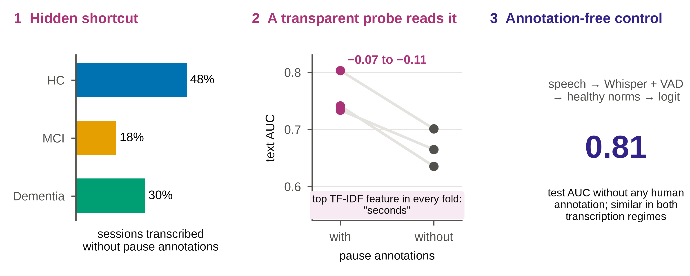
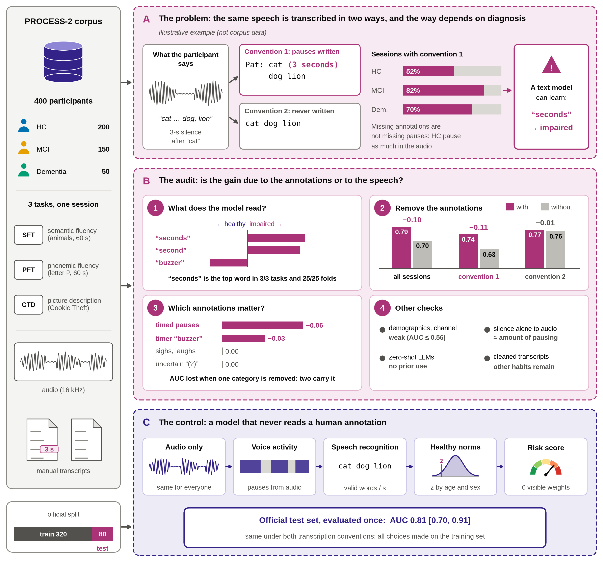

<div align="center">

# Annotation Shortcuts in Speech-Based Cognitive Impairment Detection

**An Audit of PROCESS-2 and an Interpretable Annotation-Free Baseline**

[Anass El Hallani](https://orcid.org/0009-0007-3449-4327) · [Adil Chakhtouna](https://orcid.org/0000-0001-5280-6020) · [Abdellah Adib](https://orcid.org/0000-0002-0670-7221)

Machine Intelligence Laboratory (LIM), Faculty of Sciences and Technologies of Mohammedia, Hassan II University of Casablanca


-lightgrey)

[](LICENSE)
[](https://doi.org/10.5281/zenodo.23323163)

</div>

<p align="center">
  
</p>

## Overview

Speech benchmarks for cognitive impairment detection can reward models for reading **how the data were
transcribed** rather than **how participants speak**. We audited PROCESS-2 (400 participants; semantic fluency,
phonemic fluency and Cookie Theft picture description) and found that timed pause annotations such as
`(3 seconds)` follow two transcription conventions, one of which is applied more often to impaired participants.
Supervised text classifiers learn this association. A model that never reads a human annotation reaches a
comparable test AUC and does not depend on the convention.

This repository contains the analysis code, frozen configurations and **aggregated** results. It contains no
participant data.

## Key findings

| | Finding | Evidence |
|---|---|---|
| 1 | Pause annotations follow two transcription regimes, assigned unevenly across diagnoses | annotated regime: odds ratio 4.4 (MCI) and 2.2 (dementia) vs. healthy controls |
| 2 | A transparent TF-IDF probe reads the annotations | the token `seconds` is the top feature in every task and in all 25 CV folds |
| 3 | Removing annotations costs AUC only where they are written | −0.07 to −0.11 (CV) and −0.07 to −0.12 (test); null outside the annotated regime |
| 4 | Two annotation categories carry the shortcut | timed pauses (≈ −0.06) and the timer marker `(buzzer sounds)` (≈ −0.03); other categories ≈ 0 |
| 5 | The shortcut is learned in training, not a prior | zero-shot local LLMs show no consistent use of annotations |
| 6 | An annotation-free model avoids it | test AUC **0.81** [0.70, 0.91], similar in both regimes |

## Method at a glance

<p align="center">
  
</p>

* **A. Shortcut audit.** Transcription regimes; a transparent TF-IDF + logistic-regression probe; ablations by
  regime and by annotation category; residual transcription habits; explicit confounds (demographics, recording
  channel, second voices); and a non-speech control for frozen speech embeddings that isolates silence *before*
  encoding.
* **B. Annotation-free control model.** Whisper ASR with word timestamps and Silero VAD provide fluency and pause
  measures, which are normed on healthy controls (Huber regression on age and sex) and combined by logistic
  regression.
* **C. Protocol.** All choices were made by 5 × 5 cross-validation on the 320 training participants, with norms
  refitted inside each fold. Configurations were frozen before each analysis, and the official test set
  (80 participants) was evaluated **once**.

## Repository structure

```
.
├── configs/            frozen, dated analysis configurations (YAML)
├── src/                reusable modules
│   ├── data.py         corpus loading (the only entry point to the raw data)
│   ├── normative.py    healthy-control norms (Huber regression, cross-fitting)
│   ├── stats.py        ICC, corrected resampled t-test, Holm correction, permutation tests
│   └── text.py         transcript cleaning (speaker labels and annotations removed)
├── scripts/            one script per analysis step, numbered in execution order (00–35)
├── results/            aggregated outputs only (CSV, JSON) and figures (results/figures/)
├── requirements.txt
└── README.md
```

## Installation

```bash
conda create -n disco python=3.11 -y
conda activate disco
pip install torch --index-url https://download.pytorch.org/whl/cu128   # choose the build for your GPU
pip install -r requirements.txt
```

All computations ran on a single 4-GB GPU (RTX 3050 Laptop), and the local language models use 4-bit
quantisation. NLTK resources (WordNet, word lists) are downloaded automatically on first use. Some Hugging Face
models (pyannote, MedGemma) require accepting their licence before download.

## Data access

PROCESS-2 is distributed by its authors under a **data use agreement** and cannot be redistributed. After obtaining
access, place the corpus as follows; this folder is never versioned:

```
data/PROCESS-2/
├── meta-info.csv
└── PROCESS-2_rec__XXX/PROCESS-2_rec__XXX__{SFT,PFT,CTD}.{wav,txt}
```

All loading goes through `src/data.py::load_dataset()`. Participant-level intermediate files are written to
`results/cache/`, which is also excluded from version control.

## Reproducing the results

Scripts are numbered in execution order, and each one writes its configuration next to its outputs.

| Step | Scripts | Main output |
|---|---|---|
| Corpus inventory and audit of explicit confounds | `00`–`03` | `results/00_inventory` to `results/03_second_voice` |
| Transcription conventions and text ablation | `04`, `06`, `08`, `17` | regimes, annotation density, probe AUCs |
| ASR, acoustic measures, norms and annotation-free model | `05`, `07`, `09`–`11` | `results/10_model_clinical_v2` |
| Official test set (**runs once**, records SHA-256 provenance) | `14` | `results/14_final_test` |
| Frozen speech embeddings and non-speech controls | `12`, `24`, `25`, `28` | `results/28_nonspeech_isolated` |
| Zero-shot local LLMs and taxonomy validation | `27`, `33` | `results/27_llm`, `results/33_llm_validate_taxonomy` |
| Regime checks, probe weights, marker taxonomy, ablation by category | `29`, `30`, `32`, `34`, `35` | `results/29_regime_checks` to `results/35_ablation_by_category` |
| Figures | `26`, `31` | `results/figures/` |

Example:

```bash
python scripts/06_pause_annotation.py
python scripts/10_model.py --config configs/model_clinical_v2.yaml
python scripts/35_ablation_by_category.py
python scripts/26_figures.py && python scripts/31_fig1_overview.py
```

The files whose SHA-256 hashes are recorded in `results/14_final_test/provenance.json` (for example
`configs/final.yaml`, `src/text.py` and `scripts/10_model.py`) are frozen: they are kept byte-for-byte as they
were when the test set was evaluated, including their original (French) comments.

`scripts/14_final_test.py` refuses to run if `results/14_final_test/` already exists, because the official test
set was evaluated once with the configuration frozen in `configs/final.yaml`. Long GPU jobs can be wrapped with
`scripts/run_with_watchdog.sh`, which restarts a job whose log stops progressing.

## Privacy and responsible use

* No recording, transcript, participant identifier or participant-level feature is included.
* Transcripts were processed by script only. Annotation forms occurring in fewer than five files were never
  displayed and are reported as counts only.
* All models, including the language models, ran locally. No commercial API was used to process the data.
* The annotation-free model is a research control for benchmark auditing, **not a clinical tool**.

## Citation

If you use this code or build on the audit, please cite:

```bibtex
@misc{elhallani2026annotation,
  author = {El Hallani, Anass and Chakhtouna, Adil and Adib, Abdellah},
  title  = {Annotation Shortcuts in Speech-Based Cognitive Impairment Detection:
            An Audit of {PROCESS-2} and an Interpretable Annotation-Free Baseline},
  year   = {2026},
  note   = {Code and aggregated results, version 1.0.0},
  doi    = {10.5281/zenodo.23323164},
  url    = {https://github.com/elhallani/process2-annotation-shortcuts}
}
```

Please also cite the corpus: Pahar et al., *PROCESS-2: A Benchmark Speech Corpus for Early Cognitive Impairment
Detection*, arXiv:2605.14888, 2026.

## License

The code is released under the [MIT License](LICENSE). The PROCESS-2 data are not covered by this license and
remain subject to the data use agreement of their authors.

## Acknowledgements

We thank the PROCESS-2 team for making the corpus available. This research was supported by the National Center
for Scientific and Technical Research (CNRST) of Morocco through the PhD-Associate Scholarship (PASS) program.

## Contact

Anass El Hallani · anasselhallani@gmail.com
